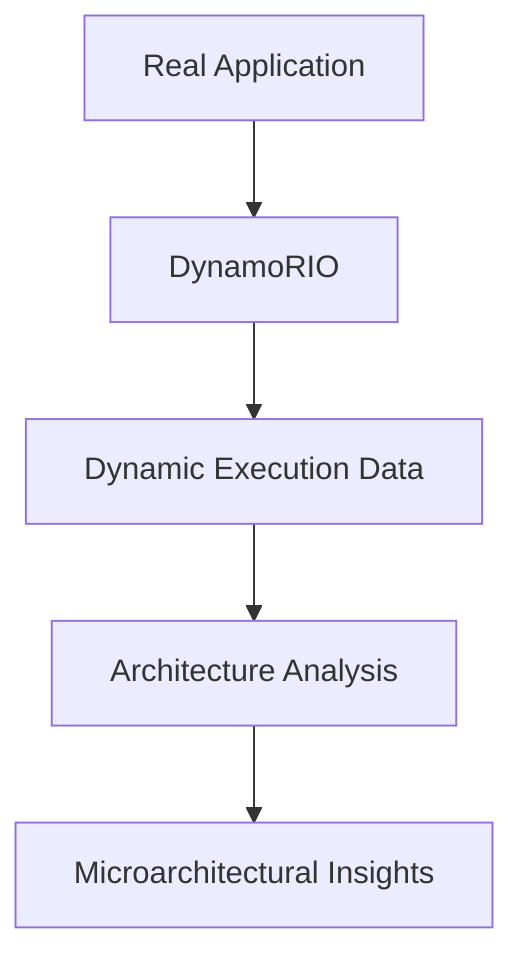

# uARCH

## Microarchitecture Exploration Lab

**From Real Program Execution to Microarchitectural Insights**

[](docs/installation.md)
[](docs/dynamorio-introduction.md)
[](LICENSE)

uARCH is a hands-on Advanced Computer Architecture lab for M.Tech students, architecture students, systems researchers, and anyone curious about how real programs execute on modern processors. The repository provides environment setup, small workloads, reusable scaffolding, and a completed first tracing exercise. Labs 2-4 will be added in later iterations.

> **Instrument -> Observe -> Analyze -> Model -> Understand**

## Why DynamoRIO?

DynamoRIO is a mature dynamic binary instrumentation framework. It can observe a compiled program at runtime without requiring source changes, making it a useful bridge between application behavior and architecture concepts such as instruction mix, control flow, locality, and dependencies. This lab uses DynamoRIO as an observation tool; it does not claim that a software trace is a complete model of any particular processor.



## Learning Objectives

By the end of the lab, students should be able to:

- Build and run small, deterministic workloads.
- Explain the role of dynamic binary instrumentation.
- Collect and interpret execution data.
- Relate control flow, memory access, and dependencies to processor behavior.
- State assumptions and limitations when moving from traces to models.
- Extend a shared DynamoRIO client structure with a focused experiment.

## Laboratory Exercises

| Lab | Focus | Status |
| --- | --- | --- |
| [01 - Instruction Profiling](lab01-instruction-profiling/README.md) | Student-driven dynamic instruction tracing and workload analysis | Guided investigation |
| [02 - Branch Prediction](lab02-branch-prediction/README.md) | Branch traces and always-taken, 1-bit, and 2-bit predictors | Template |
| [03 - Cache Locality](lab03-cache-locality/README.md) | `drcachesim`, cache configurations, and locality | Template |
| [04 - Dynamic ILP](lab04-dynamic-ilp/README.md) | Operands, dependencies, critical paths, and ideal issue width | Template |

## Architecture Concepts

The lab connects execution traces with dynamic instruction mix, basic blocks, hot paths, branches, prediction accuracy, cache capacity and associativity, cache lines, locality, register dependencies, dependency graphs, critical paths, and idealized instruction-level parallelism. Results must always be interpreted in the context of the workload, compiler, binary, input, and machine.

## Prerequisites

- Basic C/C++ and command-line experience.
- Familiarity with compilation and processes.
- A 64-bit Ubuntu Linux system is the primary target.
- GCC/G++, CMake, Make, Python 3, Git, curl, and the pinned official DynamoRIO package installed by setup.

macOS and other Unix-like systems may work for parts of the repository, but the lab scripts and examples are validated primarily on Ubuntu Linux. Windows users should use a Linux virtual machine or WSL2 and verify DynamoRIO compatibility there.

## Installation and First Run

The default setup uses the pinned official DynamoRIO prebuilt package recorded in `dynamorio-version.txt`. It does not clone DynamoRIO source, build it, or fetch an unpinned latest release:

```bash
git clone https://github.com/GandholiSarat/uARCH.git
cd uARCH
./setup.sh
./test.sh
```

`DYNAMORIO_HOME` can be set to use an existing custom installation. See [installation](docs/installation.md), [getting started](docs/getting-started.md), and [troubleshooting](docs/troubleshooting.md) for details. The current setup validates prerequisites and creates local workspace directories; Lab 1 uses the official `instrace_simple` sample, while Labs 2-4 remain templates.

## Repository Layout

```text
common/                       Shared future client/build infrastructure
workloads/                    Small workload categories and placeholders
lab01-instruction-profiling/  Lab 1 README, analyser scaffold, questions, and workloads
lab02-branch-prediction/     Lab 2 learning materials and future starter code
lab03-cache-locality/        Lab 3 configuration and analysis placeholders
lab04-dynamic-ilp/           Lab 4 learning materials and future starter code
final-challenge/             Capstone brief placeholder
docs/                        Installation and lab documentation
scripts/                     Environment checks
```

Generated binaries, traces, and build directories are intentionally excluded from version control. Instructor reference solutions should live in a separate private repository.

## Contributing

Please read [CONTRIBUTING.md](CONTRIBUTING.md) before opening an issue or pull request. Contributions should be portable, reproducible, documented, and scoped to the educational objective. Do not include generated artifacts or private instructor solutions.

## License

This project is released under the [MIT License](LICENSE). DynamoRIO is a separate project and remains subject to its own license and terms.
